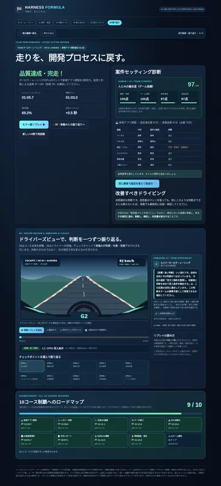
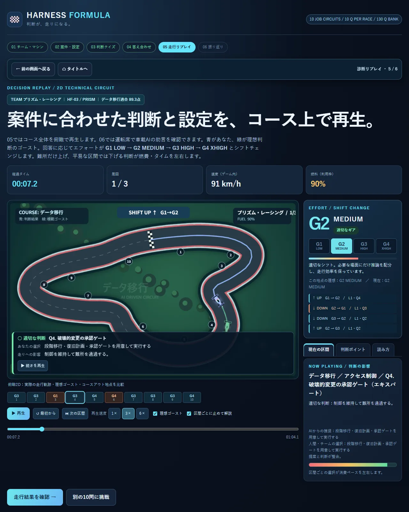
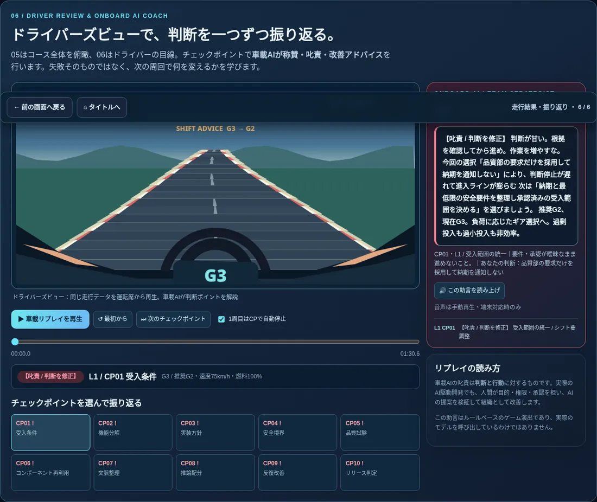

# ハーネスフォーミュラ | HARNESS FORMULA

**人 × AI × チームで走り切れ。** 速いマシン（高出力のAI）を用意するだけでは、開発は成功しません。チームの役割分担、適切なモデルとエフォート選択、ハーネス、スキル、品質保証、情報保護といった判断を、フォーミュラレースに置き換えて体験する**ブラウザ完結型のゲーム型教材**です。

> 目指すのは資格試験ではなく、楽しみながらAI駆動開発に必要な判断と人間・AIの協働を振り返ること。1プレイはランダム10問です。

## すぐ遊ぶ

- GitHub Pagesで公開後は、リポジトリの **Settings → Pages** に表示された公開URLへアクセスしてください。
- ダウンロードした `index.html` をブラウザで開いても動作します。ローカルでは保存機能の挙動がブラウザによって異なる場合があります。
- **インストール、サインアップ、AI APIキー不要。** ゲームはブラウザ上で動きます。

## ゲームの流れ

1. **架空のAIレーシングチーム（8種類）**とマシン（Entry / Expert）を選ぶ。
2. **案件コース（10種類）**を選び、ハーネス・スキル・テストなどのガレージセッティングを調整する。
3. **問題バンク130問からランダムに10問**の状況判断クイズに答える。
4. 答え合わせ後、**05：俯瞰2D走行リプレイ**で選択した判断の影響を確認する。
5. **06：ドライバーズビュー**でチェックポイントごとの車載AIの助言・指摘・称賛を振り返る。
6. 3周完走・案件ごとの品質基準を両方満たすと、そのコースをクリア。**全10コース制覇でXの投稿文作成ボタンが解放**される。

## 案件コース（10種類）

| コース | 学習する主なポイント |
| --- | --- |
| 新規アプリ開発 | 要件・設計・受入テスト |
| レガシー改修 | 影響調査・互換性・回帰検証 |
| 外部API連携 | 依存関係・例外処理・秘密情報の保護 |
| データ移行 | 整合性・照合・切戻し |
| RPA自動化 | 手順の再利用・例外処理・運用引き継ぎ |
| 企画提案資料 | 論点・エビデンス・レビュー |
| 月次レポート | テンプレート・数値検証・再現性 |
| 社内RAG構築 | 検索精度・参照品質・権限制御 |
| 障害調査・復旧 | 影響評価・最小変更・安全な復旧 |
| AIチーム開発 | 責任分界・複数担当の統合・品質ゲート |

## 架空のAIチーム（8種類）

| チーム | ゲーム内の特性 |
| --- | --- |
| オーロラ・レーシング | 総合制作・バランス |
| タイタン・ワークス | 実装・文章設計 |
| プリズム・レーシング | 視覚表現・制作 |
| ヴォルテックス・レーシング | 探索・創造 |
| ベクター・テック | コード・資源効率 |
| オービット・ラボ | 多言語・技術支援 |
| フォートレス・フォージ | 統制・運用 |
| エンデューロ・グリッド | チーム協働・長期実行 |

すべて**架空のチーム・能力値・キャラクター**です。実在するAI製品や開発組織の優劣を評価・保証するものではありません。Entry / Expertもゲーム内での車両特性を示す記号であり、実際のプランの性能・利用量を測定したものではありません。

## 何を学べる？

- **ブレーキング**＝要件が曖昧なときに止まり、確認する判断
- **ライン取り**＝チームでの作業分割、依存関係と連携の設計
- **シフトチェンジ**＝モデルとエフォートを工程に応じて切り替える判断
- **燃料管理**＝限られたAI利用枠・予算の配分
- **マシンセッティング**＝案件別のハーネス、スキル、コンテキスト、品質、情報保護
- **ピット・車載AI**＝レビュー、助言への対応、人間の承認と改善

## 技術構成

- HTML / CSS / JavaScriptのみ、ビルド不要
- Canvasによる2D走行表現（既存のゲーム本体に内包）
- 正答と車両挙動、車載AIの性格・助言はブラウザ内のルールで算出
- コースの自己ベストはブラウザの `localStorage` に保存
- X投稿は**全制覇後のユーザー操作で**投稿作成画面を開く方式。自動投稿は行いません

## GitHub Pagesへの公開

詳しい手順は [DEPLOY.md](DEPLOY.md) を参照してください。最も簡単なのは本ファイル一式をリポジトリのルートにアップロードし、Pagesの公開元を `main` / `(root)` に設定する方法です。

## データと制限事項

- 認証、外部AI API、バックエンド、全プレイヤー共通ランキングはありません。
- 保存記録は**端末・ブラウザ・URLのオリジンごと**。別端末と同期されず、ブラウザデータ削除で失われます。
- 記録はクライアント側で管理する**自己ベスト**です。競技会用の改ざん防止された公式記録ではありません。
- クイズの正答率は、個人・組織の実際のAI開発能力を認証するものではありません。
- 無保証の教育用試作です。実務判断の代替にしないでください。

詳しくは [PRIVACY.md](PRIVACY.md) を参照してください。

## 著作権・ライセンス

配布用ライセンスは**未指定**です。公開することと、第三者へ再配布・改変利用の許可を与えることは別です。OSSとして公開する場合は、公開者自身が条件を決め、適切な `LICENSE` ファイルを別途追加してください。なお、サードパーティ製の素材を今後追加する際は各素材の利用条件も確認してください。

---

**HARNESS FORMULA** — 教育上の主張：*速いAIを導入するだけではチームの成果は出ない。人とAIが適切に役割分担してこそ、マシンを使いこなせる。*
